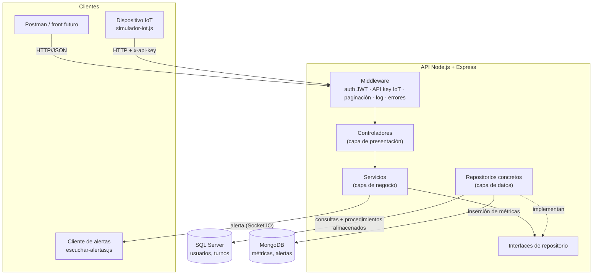
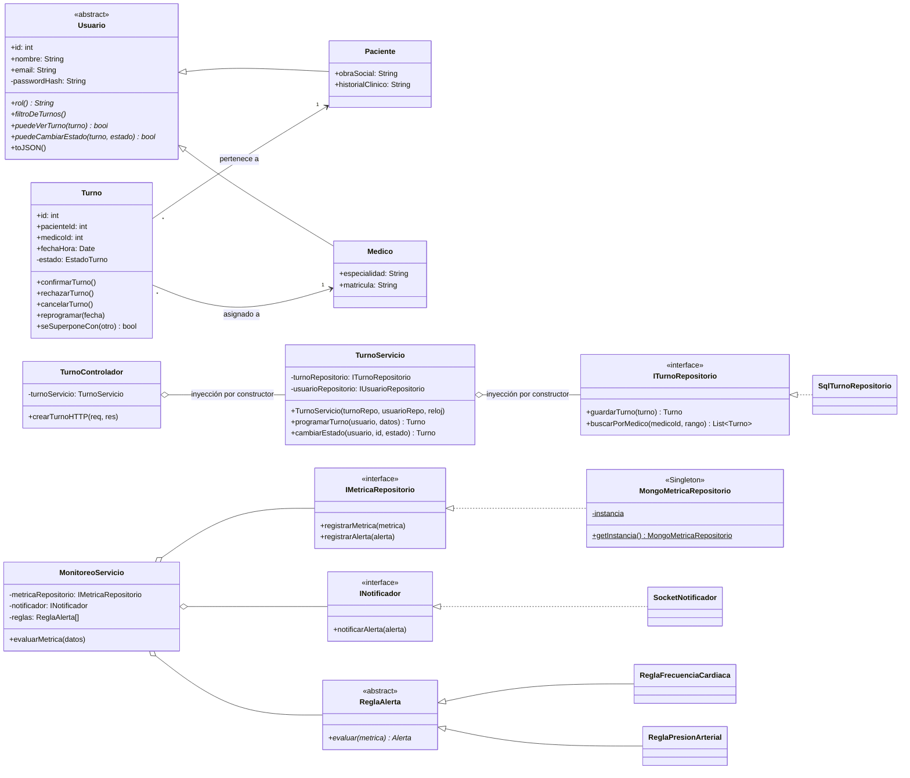
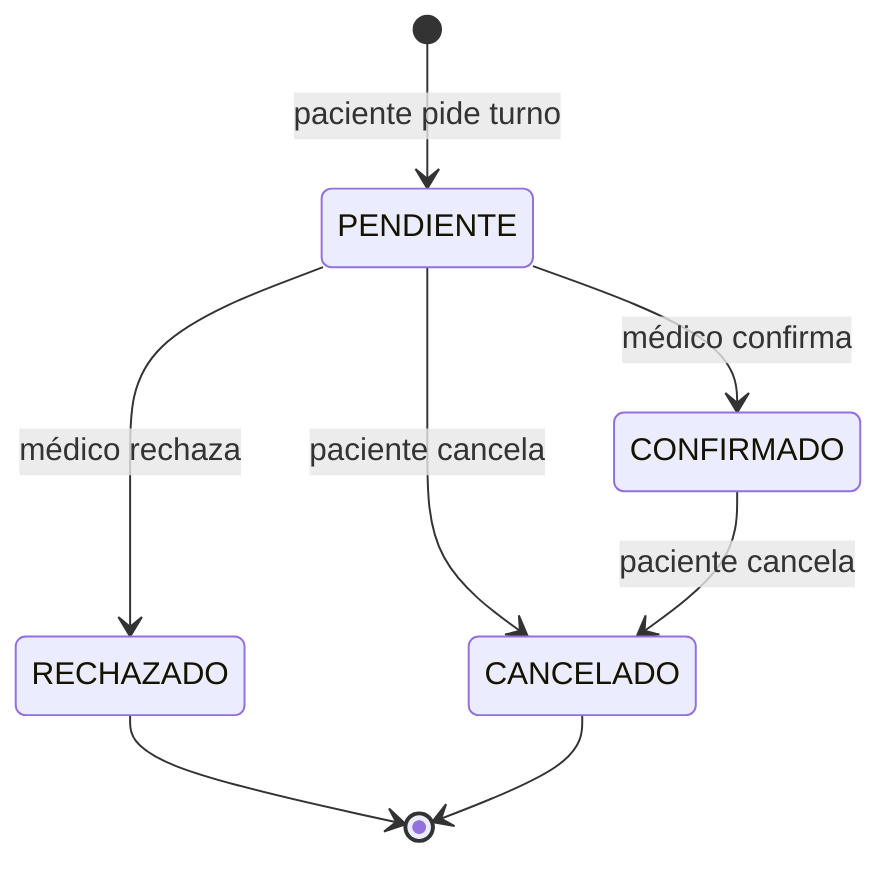
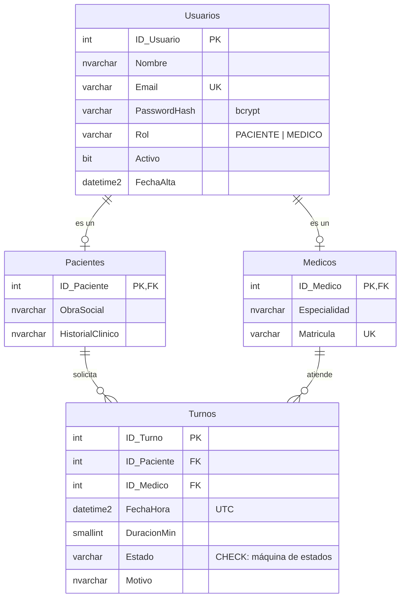
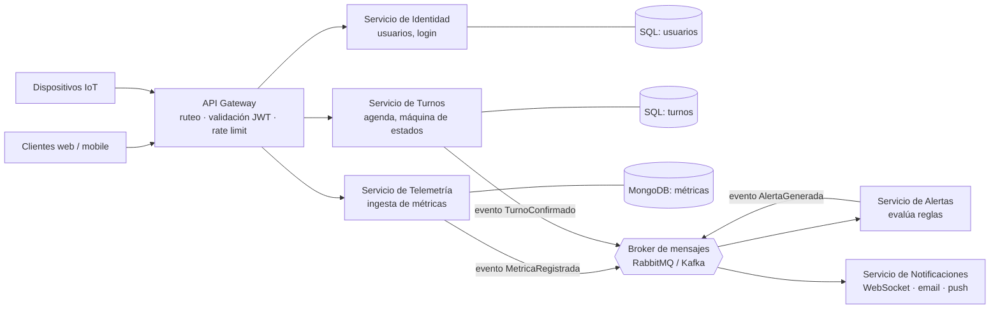

# Centro Médico con Telemedicina — API REST

Trabajo Práctico Integrador · **Técnicas Avanzadas de la Programación** · Universidad de Palermo
Alumno: **Agustín Werner** · Docente: **María Alegre**

API para gestionar un centro médico: **turnos** (pacientes, médicos y agenda) y un módulo de
**telemedicina** que recibe métricas biométricas de dispositivos IoT, detecta valores anormales y
avisa a los médicos **en tiempo real**.

Es la implementación de lo planteado en la primera entrega: arquitectura en N capas, persistencia
políglota (SQL Server + MongoDB), paradigma de objetos e inyección de dependencias.

---

## Índice

1. [Cómo se cumple cada consigna](#1-cómo-se-cumple-cada-consigna)
2. [Arquitectura](#2-arquitectura)
3. [Estructura del proyecto](#3-estructura-del-proyecto)
4. [Diagrama de clases y patrones](#4-diagrama-de-clases-y-patrones)
5. [Modelo de datos](#5-modelo-de-datos)
6. [Tecnologías](#6-tecnologías)
7. [Cómo levantarlo](#7-cómo-levantarlo)
8. [Datos precargados](#8-datos-precargados)
9. [Endpoints](#9-endpoints)
10. [Alertas en tiempo real (WebSockets)](#10-alertas-en-tiempo-real-websockets)
11. [Tests](#11-tests)
12. [Recorrido para la demo](#12-recorrido-para-la-demo)
13. [Microservicios: cómo se aplicarían](#13-microservicios-cómo-se-aplicarían)
14. [Cambios respecto de la primera entrega](#14-cambios-respecto-de-la-primera-entrega)

---

## 1. Cómo se cumple cada consigna

| Consigna | Dónde se ve |
|---|---|
| **Modelo cliente-servidor** | La API (servidor) atiende a varios clientes independientes: Postman, el simulador de dispositivo IoT (`scripts/simulador-iot.js`) y el cliente WebSocket de alertas (`scripts/escuchar-alertas.js`). |
| **Modelo API, frontend desacoplado** | API REST que solo devuelve JSON. No hay HTML ni vistas en el backend: cualquier front (web, mobile) podría consumirla. CORS habilitado. |
| **Paradigma de objetos** | Clases de dominio con encapsulamiento (`#estado`, `#passwordHash`), herencia (`Usuario` → `Paciente` / `Medico`), clases abstractas e "interfaces", polimorfismo (cada usuario decide qué puede hacer). |
| **Inyección de dependencias** | Los servicios reciben sus dependencias por constructor y dependen de interfaces, no de bases concretas (ver [§4](#4-diagrama-de-clases-y-patrones)). Todo se conecta en un solo lugar: `index.js`. |

---

## 2. Arquitectura

Arquitectura en **N capas**. Cada capa solo conoce a la de abajo, y la capa de negocio depende de
**abstracciones** (interfaces), no de SQL Server ni de MongoDB.



**Por qué dos bases:** los turnos necesitan transacciones y relaciones (no puede haber dos turnos
superpuestos), y eso lo resuelve bien un motor relacional. Las métricas IoT son muchas escrituras
chicas por segundo, sin relaciones; en MongoDB se guardan en una *time series collection* sin
cargar a la base transaccional.

---

## 3. Estructura del proyecto

```
├── index.js               # Punto de entrada: crea conexiones, repos y servicios (inyección de dependencias)
├── app.js                 # Arma la app Express a partir de los servicios recibidos
├── routes/                # Mapa de endpoints: anónimos / dispositivos IoT / privados
├── controllers/           # Capa de presentación: HTTP <-> servicio, sin lógica de negocio
├── middleware/            # Autenticación JWT, roles, API key IoT, paginación, logging, errores
├── services/              # Capa de negocio: TurnoServicio, MonitoreoServicio, AuthServicio, MedicoServicio
├── models/                # Dominio: Usuario, Paciente, Medico, Turno, MetricaIoT, Alerta, reglas de alerta
├── repositories/
│   ├── interfaces/        # ITurnoRepositorio, IUsuarioRepositorio, IMetricaRepositorio
│   ├── sql/               # Implementación SQL Server (mssql)
│   └── mongo/             # Implementación MongoDB (mongoose) — Singleton
├── notificadores/         # INotificador + SocketNotificador (WebSockets)
├── config/                # Variables de entorno, conexión SQL, Mongo y Socket.IO
├── database/              # Scripts SQL: esquema y procedimientos almacenados
├── scripts/               # init-db (crea base + datos de prueba), simulador IoT, cliente de alertas
├── tests/                 # Tests unitarios (mocks) y de API (supertest)
├── docs/postman/          # Colección de Postman para probar todo
├── Dockerfile
├── docker-compose.yml     # SQL Server + MongoDB + API
└── .env.example           # Modelo del .env (el .env real no se sube)
```

---

## 4. Diagrama de clases y patrones



### Inyección de dependencias (DIP)

`TurnoServicio` no sabe que existe SQL Server: recibe "algo que cumpla `ITurnoRepositorio`".
El único lugar que elige las implementaciones concretas es `index.js` (raíz de composición):

```js
// index.js
const turnoServicio = new TurnoServicio(new SqlTurnoRepositorio(pool), new SqlUsuarioRepositorio(pool));
const monitoreoServicio = new MonitoreoServicio(
  MongoMetricaRepositorio.getInstancia(),      // repositorio (Singleton)
  new SocketNotificador(io),                   // a quién avisar
  [new ReglaFrecuenciaCardiaca(), new ReglaPresionArterial()] // qué evaluar
);
```

En los tests se inyectan **mocks** o **repositorios en memoria** y la lógica se prueba sin bases.

### Patrones y principios aplicados

| Patrón / principio | Dónde |
|---|---|
| **Inyección de dependencias / DIP** | Servicios ← repositorios, notificador, reglas y reloj. Controladores ← servicios. Middleware ← AuthServicio. |
| **Singleton** | `MongoMetricaRepositorio.getInstancia()` (el constructor está bloqueado). |
| **Factory** | `UsuarioFactory` crea `Paciente` o `Medico` según el rol (al leer de la base o del JWT). |
| **Strategy** | Reglas de alerta intercambiables (`ReglaAlerta`). Agregar una regla nueva no modifica el servicio (abierto/cerrado). |
| **Repository** | Toda la persistencia pasa por interfaces de repositorio. |
| **Máquina de estados** | `Turno`: `PENDIENTE → CONFIRMADO / RECHAZADO / CANCELADO`, `CONFIRMADO → CANCELADO`. |
| **Polimorfismo** | `usuario.filtroDeTurnos()`, `usuario.puedeCambiarEstado()`: el servicio no pregunta "¿qué rol tenés?", le pregunta al objeto. |
| **Encapsulamiento** | `#estado` del turno solo cambia por la máquina de estados; `#passwordHash` nunca sale en el JSON. |



---

## 5. Modelo de datos

### Relacional (SQL Server)



Scripts: [`database/01_esquema.sql`](database/01_esquema.sql) y
[`database/02_procedimientos.sql`](database/02_procedimientos.sql).

**Procedimientos almacenados**

| Procedimiento | Qué hace |
|---|---|
| `sp_Paciente_Registrar` | Alta de `Usuarios` + `Pacientes` en una sola transacción. |
| `sp_Turno_Crear` | Valida que el médico exista y que **no haya superposición** dentro de una transacción con `UPDLOCK, HOLDLOCK`: si dos pacientes piden el mismo horario a la vez, solo uno lo obtiene. |
| `sp_Turno_Reprogramar` | Igual que el anterior, excluyendo el propio turno, y solo si está `PENDIENTE`. |

La superposición se valida **dos veces a propósito**: en `TurnoServicio` (regla de negocio
testeable con mocks y error claro) y en el procedimiento (garantía ante concurrencia).

### Documental (MongoDB)

Colección `metricas` (*time series*, `timeField: timestamp`, `metaField: pacienteId`):

```json
{
  "pacienteId": 4,
  "timestamp": "2026-11-16T14:28:37Z",
  "frecuenciaCardiaca": 88,
  "presionArterial": "120/80",
  "dispositivoId": "reloj-sim-4"
}
```

Colección `alertas`:

```json
{
  "pacienteId": 4,
  "tipo": "TAQUICARDIA",
  "nivel": "ADVERTENCIA",
  "mensaje": "Frecuencia cardíaca de 130 lpm fuera del rango normal (50-120)",
  "valor": "130",
  "metricaTimestamp": "2026-11-16T14:28:37Z",
  "creadaEn": "2026-11-16T14:28:37Z"
}
```

---

## 6. Tecnologías

| Tecnología | Para qué | Por qué |
|---|---|---|
| **Node.js + Express** | API REST | Asíncrono y liviano, ideal para muchas peticiones de E/S (IoT). Express permite estructurar controladores y middleware como se vio en clase. |
| **SQL Server** (`mssql`) | Usuarios y turnos | Transacciones, integridad referencial y procedimientos almacenados para la agenda. |
| **MongoDB** (`mongoose`) | Métricas y alertas | Inserciones rápidas y esquema flexible; colección *time series* para datos de sensores. |
| **Socket.IO** | Alertas en tiempo real | Conexión persistente (WebSocket) para avisar al médico sin que tenga que consultar. |
| **JWT** (`jsonwebtoken`) | Autenticación | Token sin estado firmado por el servidor; viaja en `Authorization: Bearer`. |
| **bcrypt** (`bcryptjs`) | Contraseñas | Hash con *salt* aleatorio y costo configurable. Nunca se guarda la contraseña plana. |
| **Jest + Supertest** | Tests | Mocks nativos (`jest.fn()`) y pruebas HTTP contra la app sin levantar el servidor. |
| **Docker Compose** | Infraestructura | Levanta SQL Server, MongoDB y la API con un comando, igual en cualquier PC. |

---

## 7. Cómo levantarlo

### Requisitos

- [Docker Desktop](https://www.docker.com/products/docker-desktop/) (opción recomendada), **o**
- Node.js 20+ con SQL Server y MongoDB propios (opción sin Docker).

### Archivo `.env`

El `.env` tiene secretos, así que **no está en el repositorio**. Hay que crearlo copiando
[`.env.example`](.env.example):

```bash
cp .env.example .env      # en Windows: copy .env.example .env
```

Contenido (completar los valores):

```ini
PORT=3000

JWT_SECRET=cambiar-por-un-secreto-largo-y-aleatorio
JWT_EXPIRA_EN=2h

IOT_API_KEY=cambiar-por-una-clave-de-dispositivo

SQL_SERVER=localhost
SQL_PORT=1433
SQL_USER=sa
SQL_PASSWORD=Cambiar!Esta1          # mayúscula, minúscula, número y símbolo
SQL_DATABASE=CentroMedico
SQL_ENCRYPT=true
SQL_TRUST_SERVER_CERTIFICATE=true

MSSQL_ACCEPT_EULA=Y                 # aceptación de la licencia de SQL Server (la exige la imagen de Docker)

MONGO_URI=mongodb://localhost:27018/centro_medico
```

### Opción A — Docker (recomendada)

```bash
docker compose up -d --build
```

Esto levanta tres contenedores:

| Contenedor | Puerto en la PC | Qué es |
|---|---|---|
| `centromedico-sqlserver` | 1433 | SQL Server 2022 |
| `centromedico-mongo` | 27018 | MongoDB 8 |
| `centromedico-api` | 3000 | La API |

Al arrancar, la API corre `scripts/init-db.js`, que **crea la base, las tablas, los procedimientos
y los datos de prueba** (solo si está vacía). Para ver el log:

```bash
docker compose logs -f api
```

Cuando aparece `[api] escuchando en http://localhost:3000`, ya se puede usar.
La primera vez tarda unos minutos porque descarga las imágenes de SQL Server y MongoDB.

Otros comandos útiles:

```bash
docker compose ps        # estado de los contenedores
docker compose down      # apaga todo (los datos quedan en los volúmenes)
docker compose down -v   # apaga y BORRA los datos: al volver a levantar se recargan los de prueba
```

### Opción B — sin Docker

Con un SQL Server y un MongoDB propios, ajustar `SQL_*` y `MONGO_URI` en el `.env` y:

```bash
npm install
npm run db:init     # crea la base y carga datos de prueba
npm start
```

Un caso intermedio útil para desarrollar: bases en Docker y API en la PC.

```bash
docker compose up -d sqlserver mongo
npm install
npm run db:init
npm run dev         # reinicia solo al guardar cambios
```

---

## 8. Datos precargados

Todos los usuarios de prueba tienen la contraseña **`Demo1234!`**.

| Id | Rol | Nombre | Email | Extra |
|---|---|---|---|---|
| 1 | MÉDICO | Dra. Laura Gómez | `laura.gomez@centromedico.test` | Cardiología · MN-10001 |
| 2 | MÉDICO | Dr. Martín Ruiz | `martin.ruiz@centromedico.test` | Clínica Médica · MN-10002 |
| 3 | MÉDICO | Dra. Sofía Benítez | `sofia.benitez@centromedico.test` | Pediatría · MN-10003 |
| 4 | PACIENTE | Juan Pérez | `juan.perez@correo.test` | OSDE |
| 5 | PACIENTE | María López | `maria.lopez@correo.test` | Swiss Medical |

Turnos de ejemplo (fechas relativas al día en que se inicializa la base):

- Juan con la Dra. Gómez, en 2 días — **CONFIRMADO**
- Juan con el Dr. Ruiz, en 3 días — **PENDIENTE**
- María con la Dra. Gómez, en 2 días — **PENDIENTE**
- María con el Dr. Ruiz, hace 5 días — **CANCELADO**

En MongoDB: 12 métricas del paciente 4 (Juan) y 1 alerta de hipertensión.

---

## 9. Endpoints

Base: `http://localhost:3000`. Todas las respuestas son JSON.

### Anónimos (no requieren autenticación)

| Método | Ruta | Descripción |
|---|---|---|
| GET | `/` | Estado de la API |
| POST | `/api/auth/registro` | Alta de paciente → `201` |
| POST | `/api/auth/login` | Devuelve `{ token, usuario }` |
| GET | `/api/medicos?especialidad=&pagina=&limite=` | Cartilla de médicos (paginada) |
| GET | `/api/medicos/:id` | Un médico |

### Dispositivos IoT (header `x-api-key`)

| Método | Ruta | Descripción |
|---|---|---|
| POST | `/api/metricas` | Registra una métrica; si es anormal genera alertas y las emite por WebSocket |

### Privados (header `Authorization: Bearer <token>`)

| Método | Ruta | Quién | Descripción |
|---|---|---|---|
| GET | `/api/auth/perfil` | todos | Datos del usuario logueado |
| GET | `/api/turnos?estado=&pagina=&limite=` | todos | El paciente ve **sus** turnos; el médico, **su agenda** |
| GET | `/api/turnos/:id` | dueño | Detalle de un turno |
| POST | `/api/turnos` | paciente | Pide turno `{ medicoId, fechaHora, motivo }` → `201 PENDIENTE` |
| PUT | `/api/turnos/:id` | paciente | Reprograma `{ fechaHora }` (solo si está PENDIENTE) |
| PATCH | `/api/turnos/:id/estado` | médico / paciente | `{ estado }`: el médico `CONFIRMADO`/`RECHAZADO`, el paciente `CANCELADO` |
| DELETE | `/api/turnos/:id` | paciente | Cancela el turno (**baja lógica**: queda `CANCELADO`, no se borra la fila) |
| GET | `/api/pacientes/:id/metricas?pagina=&limite=` | médico / el propio paciente | Historial de métricas |
| GET | `/api/alertas?pacienteId=&pagina=&limite=` | médico | Alertas generadas |

### Paginación

Todos los listados aceptan `?pagina=1&limite=10` (máximo 100) y responden:

```json
{
  "datos": [ ... ],
  "paginacion": { "pagina": 1, "limite": 10, "total": 23, "totalPaginas": 3 }
}
```

### Códigos de respuesta

| Código | Cuándo |
|---|---|
| 200 / 201 | OK / creado |
| 400 | Datos inválidos (`{ "error": "fechaHora debe ser una fecha válida (ISO 8601)" }`) |
| 401 | Sin token, token vencido o API key inválida |
| 403 | Autenticado pero sin permiso (ej. un paciente confirmando un turno) |
| 404 | No existe el recurso o el endpoint |
| 409 | Conflicto de negocio: horario ocupado, email repetido, transición de estado inválida |
| 500 | Error inesperado (se loguea en el servidor; al cliente no se le muestran detalles) |

---

## 10. Alertas en tiempo real (WebSockets)

1. Un médico se conecta por Socket.IO mandando su JWT: `io(url, { auth: { token } })`.
2. El servidor valida el token y lo agrega a la sala `medicos`.
3. Cuando un dispositivo manda una métrica anormal, `MonitoreoServicio` genera la alerta,
   la guarda en MongoDB y `SocketNotificador` la emite a la sala con el evento `alerta`.

Para verlo funcionando, en dos terminales:

```bash
# Terminal 1: la Dra. Gómez queda escuchando alertas
npm run alertas

# Terminal 2: un reloj inteligente manda lecturas del paciente 4 (cada 5, una anormal)
npm run simulador -- --paciente 4 --intervalo 1500 --cantidad 15
```

---

## 11. Tests

```bash
npm test               # corre todos
npm run test:cobertura # con reporte de cobertura
```

No necesitan bases de datos ni Docker: gracias a la inyección de dependencias se reemplazan los
repositorios por **mocks** (`jest.fn()`) o por **repositorios en memoria** (`tests/dobles/`).

| Archivo | Tipo | Qué prueba |
|---|---|---|
| `tests/unit/Turno.test.js` | Unitario | Máquina de estados (transiciones válidas e inválidas) y cálculo de superposición. |
| `tests/unit/TurnoServicio.test.js` | Unitario con mocks | Alta con médico libre/ocupado, turnos cancelados que no bloquean, fechas pasadas (reloj inyectado), permisos por rol, concurrencia optimista, reprogramación. |
| `tests/unit/MonitoreoServicio.test.js` | Unitario con mocks | Métricas normales/anormales, niveles de alerta, notificación en tiempo real, validación, permisos. |
| `tests/unit/AuthServicio.test.js` | Unitario | Hash de contraseña, email duplicado, login, JWT, usuario inactivo. |
| `tests/unit/Modelos.test.js` | Unitario | Clase abstracta, herencia, polimorfismo, encapsulamiento, Singleton, Factory. |
| `tests/api/api.test.js` | Integración HTTP | Endpoints anónimos vs privados, paginación, flujo completo del turno (registro → login → pedir → reprogramar → confirmar → cancelar), IoT con/sin API key. |

---

## 12. Recorrido para la demo

Con la API levantada, importar en Postman
[`docs/postman/CentroMedico.postman_collection.json`](docs/postman/CentroMedico.postman_collection.json),
completar la variable `iotApiKey` con el valor del `.env` y correr las carpetas en orden:

1. **Anónimos:** estado de la API, cartilla de médicos paginada, registro de paciente, y un
   endpoint privado sin token → `401`.
2. **Paciente:** login (el token se guarda solo), pedir turno con la Dra. Gómez → `201 PENDIENTE`;
   pedir el mismo horario → `409`; reprogramar (`PUT`); intentar confirmarlo → `403`.
3. **Médico:** login, ver agenda, **confirmar** (`PATCH`); el médico no puede pedir turnos → `403`;
   el paciente cancela (`DELETE`, baja lógica).
4. **IoT:** métrica normal, métrica anormal (genera alertas), sin API key → `401`, el médico
   consulta métricas y alertas, el paciente no puede ver alertas → `403`.
5. **Tiempo real:** `npm run alertas` + `npm run simulador` en dos terminales.
6. **Tests:** `npm test`.

---

## 13. Microservicios: cómo se aplicarían

> Para el alcance del TP se implementó un **monolito modular en capas**. Esta sección explica cómo
> se podría llevar a microservicios en un escenario hipotético de crecimiento.

**Escenario:** la plataforma pasa a atender una red de 50 clínicas y 20.000 pacientes con
dispositivos que mandan una lectura cada 10 segundos (~2.000 escrituras por segundo). La ingesta IoT
crece mucho más rápido que la gestión de turnos, y una caída del módulo IoT no debería impedir que
alguien saque un turno.



**Cómo se dividiría:**

| Microservicio | Responsabilidad | Base propia |
|---|---|---|
| Identidad | Registro, login, emisión de JWT | SQL (usuarios) |
| Turnos | Agenda, superposición, máquina de estados | SQL (turnos) |
| Telemetría | Recibir y guardar métricas a alta velocidad | MongoDB time series |
| Alertas | Evaluar reglas sobre cada métrica | — / Mongo (alertas) |
| Notificaciones | Avisar por WebSocket, email o push | — |

- **API Gateway:** punto de entrada único; valida el JWT una vez y enruta.
- **Una base por servicio:** ningún servicio lee la base de otro; se comunican por API o eventos.
- **Comunicación asíncrona:** Telemetría publica `MetricaRegistrada` y responde enseguida; Alertas
  la procesa a su ritmo. Si hay un pico, los mensajes se encolan en lugar de tirar el sistema.

**Ventajas:** escalar solo Telemetría (más instancias) sin tocar Turnos; fallas aisladas;
despliegues independientes; cada equipo con su servicio.

**Costos:** más infraestructura (gateway, broker, varios despliegues), **consistencia eventual**
(ej. el turno se confirma y el email llega unos segundos después), trazabilidad distribuida y
latencia de red entre servicios. Por eso, para un equipo de una persona y este volumen, el monolito
en capas es la opción correcta.

**El diseño actual ya está preparado:** como los servicios dependen de interfaces, extraer un
microservicio es cambiar implementaciones en `index.js`. Por ejemplo, `MonitoreoServicio` usa
`INotificador`: reemplazar `SocketNotificador` por un `BrokerNotificador` que publique el evento
`AlertaGenerada` en RabbitMQ no requiere tocar ni una línea del servicio.

---

## 14. Cambios respecto de la primera entrega

| Primera entrega | Implementación | Motivo |
|---|---|---|
| Estados: Pendiente, Confirmado, Rechazado | Se agregó **CANCELADO** | El paciente necesita poder cancelar; sigue siendo un estado final (ningún proceso queda inconcluso). |
| Backend "Node.js / Python" | **Node.js + Express** | Mismo stack que los ejemplos de la cursada; un solo lenguaje para API, scripts y tests. |
| Superposición validada en el motor | En el **servicio y en el procedimiento** | El servicio se testea con mocks (plan de testing); el procedimiento garantiza consistencia ante concurrencia. |
| Alertas evaluadas en `MonitoreoServicio` | Reglas como **Strategy** inyectadas | Agregar reglas sin modificar el servicio. |
| — | `INotificador` inyectado en `MonitoreoServicio` | Segunda relación con inyección de dependencias y punto de extensión hacia microservicios. |
| — | DELETE como **baja lógica** | En un sistema médico no se borran registros; el turno queda `CANCELADO`. |
